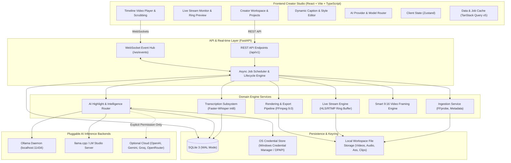
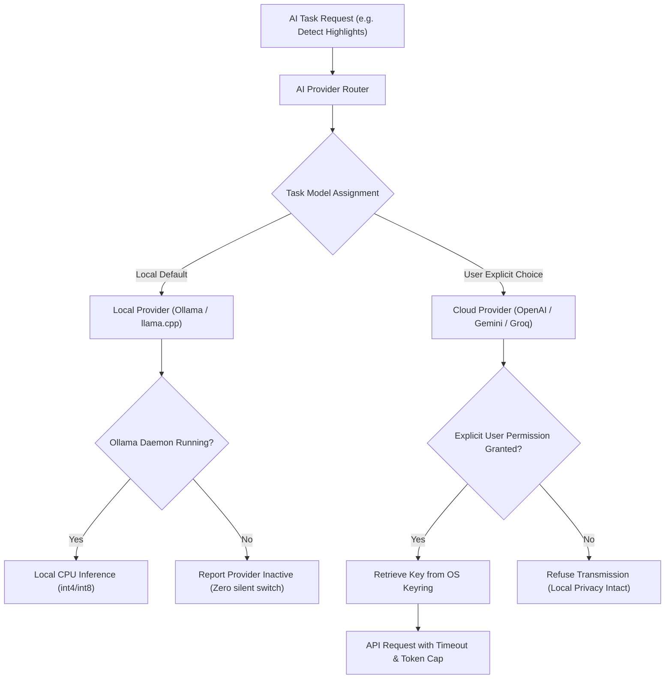
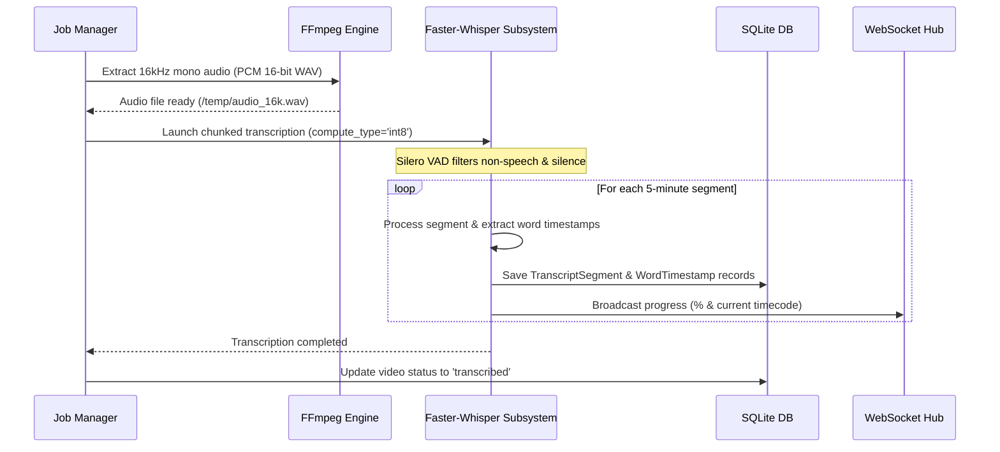
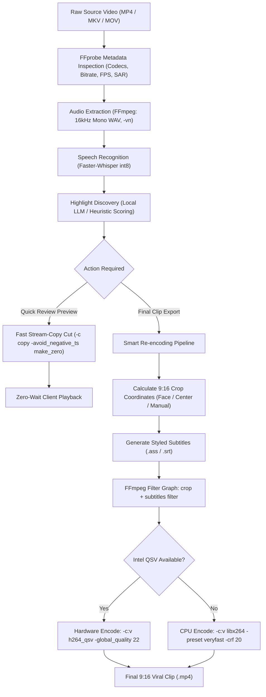
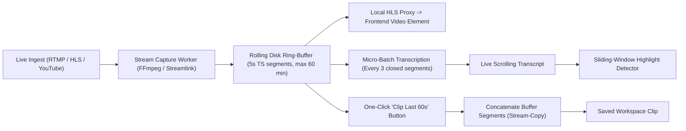
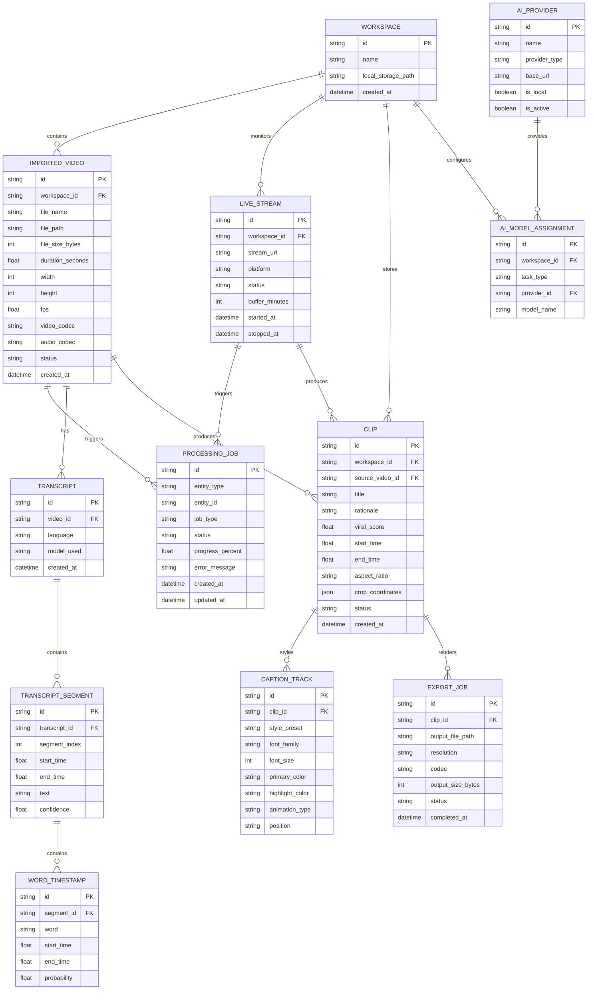

# CLIPSTUDIO — INDEPENDENT SOFTWARE ARCHITECTURE BLUEPRINT

> **Document Version:** 1.0.0  
> **Target Platform:** ClipStudio  
> **Working Directory:** `D:\dharmendra\clipstudio`  
> **Repository:** `https://github.com/dharmendramawlemawle/ClipStudio.git`  
> **Status:** Architectural Blueprint & Specification (No implementation yet)

---

## 1. Executive Summary & Product Vision

ClipStudio is an **independent, local-first, AI-augmented video clipping and creator workspace platform**. It empowers content creators, live streamers, and video editors to:
1. Ingest long-form media (recorded podcasts, VODs, gaming sessions) and monitor real-time live streams (RTMP, HLS, YouTube, Twitch).
2. Transcribe multi-speaker audio with word-level timestamps using high-efficiency local speech models.
3. Automatically detect narrative hooks, virality spikes, and emotional highlights using local or optional cloud LLMs.
4. Intelligently crop and re-frame horizontal (16:9) video into vertical (9:16) short-form content (TikTok, Reels, YouTube Shorts).
5. Edit dynamic, word-animated captions and preview cuts in real time without waiting for full re-encodes.
6. Export publication-ready, hardware-optimized video files with synchronized burned-in or soft subtitles.

### Core Architectural Tenets
- **Local-First Privacy & Zero-Cloud-Cost**: Full pipeline (ingest, speech recognition, highlight scoring, rendering) functions entirely offline on consumer hardware with zero data transmission to external servers by default.
- **Hardware-Aware Adaptive Scheduling**: Tailored to run efficiently on 4-core/8-thread laptop CPUs (Intel Core i5-1135G7) with 16 GB RAM and integrated graphics (Intel Iris Xe), preventing system lockups through concurrency throttling and low-bitwidth quantization.
- **Modular Micro-Services inside a Monorepo**: Decoupled domain engines (Ingestion, Transcription, Highlight, Framing, Rendering, LiveStream, AI Provider) coordinated via an async FastAPI core and a responsive React creator studio.
- **Strict PeakCut Independence**: PeakCut serves solely as an external visual/functional UX benchmark. Zero code, components, schemas, or history are derived from PeakCut.

---

## 2. Target Hardware Constraints & Resource Budget

The reference development and execution target is an Intel Core i5 mobile workstation:

| Hardware Component | Detected Specification | Operational Resource Allocation |
| :--- | :--- | :--- |
| **CPU** | Intel Core i5-1135G7 @ 2.40GHz (4 Cores / 8 Threads, AVX-512 supported) | Maximum 4 concurrent worker threads for CPU compute (leaving 4 threads for OS/UI responsiveness) |
| **RAM** | 16.0 GB Total (~6.6 GB currently free) | Hard memory ceiling: **3.5 GB** for Local LLM, **1.2 GB** for Whisper, **1.5 GB** for FFmpeg processing buffer |
| **GPU** | Intel Iris Xe Graphics (Integrated, shared VRAM) | OpenCL/VAAPI/QSV hardware acceleration for FFmpeg decode/encode (`h264_qsv` where available); CPU for AI inference |
| **Storage / Disk** | Fast NVMe / SSD | SQLite Write-Ahead Logging (WAL); rolling disk ring-buffer for live streams (capped at 5–10 GB) |
| **Runtime Dependencies** | Python 3.10.10, Node.js 26.13.1, FFmpeg 9.0.2-full, Ollama 0.40.16 | Zero external cloud service prerequisites |

### AI Model Recommendations for 16GB Non-CUDA Hardware
- **Local LLM**: `Llama-3.2-3B-Instruct-Q4_K_M` (Ollama, ~2.0 GB RAM footprint) or `Qwen2.5-1.5B-Instruct-Q4_K_M` (~1.2 GB RAM). These deliver fast token generation on CPU AVX2/AVX-512 without starving system RAM.
- **Speech-to-Text**: `faster-whisper-small` or `faster-whisper-base` with `compute_type="int8"` on CPU (~500 MB – 1.0 GB RAM).
- **Prohibited by Default**: 70B models, unquantized fp16/fp32 models, or models exceeding 4.5 GB memory footprint without explicit user override.

---

## 3. High-Level System Architecture



---

## 4. Frontend Architecture

### 4.1 Technology Stack Selection & Rationale
- **Framework**: React 19 + TypeScript 5.8 + Vite 6.
  - *Rationale*: Blazing fast HMR, small bundle size, strict type safety for media timestamps and framing coordinates.
- **Styling & Design System**: Tailwind CSS v4 + Radix UI Primitives + Lucide Icons.
  - *Rationale*: Accessible, headless primitives (dialogs, dropdowns, sliders, tabs) styled with high-density dark-mode creator aesthetics.
- **State Management**:
  - **Server State**: `@tanstack/react-query` (v5) for caching, optimistic updates, and background polling.
  - **Client & Playback State**: `zustand` for lightweight, decoupled player state, active timecodes, framing box coordinates, and caption styling.
- **Routing**: `react-router-dom` (v7) for nested project workspaces, settings, and full-screen preview modes.
- **Video Playback & Timeline**: Custom HTML5 `<video>` player synchronized with HTML5 Canvas / WebGL overlay for zero-latency framing previews and subtitle rendering.

### 4.2 Proposed Frontend Directory Structure
```
clipstudio-frontend/
├── index.html
├── package.json
├── tsconfig.json
├── vite.config.ts
├── tailwind.config.js
├── src/
│   ├── main.tsx
│   ├── App.tsx
│   ├── assets/                 # SVGs, brand marks, placeholder media
│   ├── components/
│   │   ├── ui/                 # Reusable Radix/shadcn primitives
│   │   │   ├── button.tsx
│   │   │   ├── dialog.tsx
│   │   │   ├── slider.tsx
│   │   │   ├── dropdown-menu.tsx
│   │   │   ├── tooltip.tsx
│   │   │   ├── progress.tsx
│   │   │   └── badge.tsx
│   │   ├── common/             # Shared app components
│   │   │   ├── Header.tsx
│   │   │   ├── Sidebar.tsx
│   │   │   ├── StatusBadge.tsx
│   │   │   └── ConfirmModal.tsx
│   │   ├── workspace/          # Dashboard & project listings
│   │   │   ├── WorkspaceCard.tsx
│   │   │   ├── VideoImportModal.tsx
│   │   │   └── LiveStreamConnectModal.tsx
│   │   ├── player/             # Video playback & timeline
│   │   │   ├── VideoPlayer.tsx
│   │   │   ├── PlaybackControls.tsx
│   │   │   ├── TimelineTrack.tsx
│   │   │   ├── WaveformView.tsx
│   │   │   ├── FramingOverlay.tsx
│   │   │   └── TimecodeDisplay.tsx
│   │   ├── captions/           # Subtitle editor & karaoke preview
│   │   │   ├── CaptionList.tsx
│   │   │   ├── CaptionSegmentItem.tsx
│   │   │   ├── WordTimingEditor.tsx
│   │   │   └── StylePicker.tsx
│   │   ├── clips/              # Highlight & clip cards
│   │   │   ├── ClipGrid.tsx
│   │   │   ├── ClipCard.tsx
│   │   │   ├── HighlightScoreBadge.tsx
│   │   │   └── ExportModal.tsx
│   │   └── livestream/         # Real-time monitoring
│   │       ├── StreamStatusHeader.tsx
│   │       ├── RollingBufferTimeline.tsx
│   │       └── InstantClipButton.tsx
│   ├── hooks/                  # Custom React hooks
│   │   ├── useVideoPlayer.ts
│   │   ├── useWebSocket.ts
│   │   ├── useJobProgress.ts
│   │   └── useKeyboardShortcuts.ts
│   ├── stores/                 # Zustand state stores
│   │   ├── usePlayerStore.ts
│   │   ├── useEditorStore.ts
│   │   ├── useLiveStreamStore.ts
│   │   └── useSettingsStore.ts
│   ├── services/               # API clients
│   │   ├── api.ts              # Axios / Fetch client with interceptors
│   │   ├── videosApi.ts
│   │   ├── clipsApi.ts
│   │   ├── liveApi.ts
│   │   └── aiProvidersApi.ts
│   ├── types/                  # TypeScript interface definitions
│   │   ├── video.ts
│   │   ├── clip.ts
│   │   ├── transcript.ts
│   │   ├── job.ts
│   │   └── ai.ts
│   └── utils/                  # Formatting & calculation utilities
│       ├── timecode.ts         # Seconds to HH:MM:SS.mmm conversions
│       ├── formatters.ts       # Byte sizing, percentages
│       └── assGenerator.ts     # Client-side subtitle export preview
```

---

## 5. Backend Architecture

### 5.1 Technology Stack Selection & Rationale
- **Framework**: Python 3.10 + FastAPI (ASGI).
  - *Rationale*: Native `asyncio`, high-throughput request handling, auto-generated OpenAPI documentation, and strict Pydantic v2 data validation.
- **ORM & Database**: SQLAlchemy 2.0 (asyncio) + Alembic + SQLite (WAL mode).
  - *Rationale*: Zero-config local persistence with zero operational overhead; SQLite with Write-Ahead Logging allows simultaneous reads and writes across background tasks and the web UI. Schema designed with PostgreSQL compatibility in mind.
- **Background Job Execution**: In-process durable async worker queue with persistent database state.
  - *Rationale*: Avoids demanding heavy external message brokers (RabbitMQ/Redis/Celery) on local desktop workstations. Jobs are tracked in a `processing_jobs` table, survive app restarts, and emit granular progress over WebSockets.
- **Real-Time Communication**: FastAPI WebSockets with broadcast channels for job progress, real-time transcription chunks, and stream health status.

### 5.2 Proposed Backend Directory Structure
```
clipstudio-backend/
├── pyproject.toml
├── alembic.ini
├── app/
│   ├── main.py                 # FastAPI application factory & startup hooks
│   ├── config.py               # App configuration & environment parsing
│   ├── database.py             # SQLite async engine & sessionmaker
│   ├── dependencies.py         # FastAPI dependency injection providers
│   ├── api/
│   │   ├── v1/
│   │   │   ├── router.py       # Main API v1 router
│   │   │   ├── videos.py       # Video upload, inspect, list, delete
│   │   │   ├── streams.py      # Live stream connect, buffer, disconnect
│   │   │   ├── transcripts.py  # Transcript retrieval & editing
│   │   │   ├── clips.py        # Clip generation, manual crop, delete
│   │   │   ├── exports.py      # Final rendering trigger & downloads
│   │   │   ├── ai_providers.py # Provider config, health, model discovery
│   │   │   └── jobs.py         # Background job status & control
│   │   └── websockets/
│   │       ├── connection.py   # ConnectionManager for active clients
│   │       └── events.py       # Event schemas & pub/sub router
│   ├── core/
│   │   ├── exceptions.py       # Custom domain exceptions
│   │   ├── security.py         # DPAPI / Windows keyring helpers
│   │   └── logging.py          # Structured rotation logger
│   ├── models/                 # SQLAlchemy 2.0 declarative models
│   │   ├── base.py
│   │   ├── workspace.py
│   │   ├── video.py
│   │   ├── stream.py
│   │   ├── transcript.py
│   │   ├── clip.py
│   │   ├── job.py
│   │   └── ai_provider.py
│   ├── schemas/                # Pydantic v2 validation models
│   │   ├── video.py
│   │   ├── stream.py
│   │   ├── transcript.py
│   │   ├── clip.py
│   │   ├── job.py
│   │   └── ai.py
│   ├── services/               # Core business & processing services
│   │   ├── ingestion_service.py
│   │   ├── live_stream_service.py
│   │   ├── transcription_service.py
│   │   ├── highlight_service.py
│   │   ├── framing_service.py
│   │   ├── rendering_service.py
│   │   ├── ai_provider_service.py
│   │   └── job_queue_service.py
│   └── utils/
│       ├── ffmpeg_runner.py    # Subprocess execution & progress parser
│       ├── srt_parser.py       # Subtitle format converters (SRT, VTT, ASS)
│       └── file_system.py      # Safe directory & path sanitization
├── migrations/                 # Alembic migration scripts
│   ├── env.py
│   └── versions/
└── tests/
    ├── conftest.py
    ├── test_api/
    ├── test_services/
    └── test_ffmpeg/
```

---

## 6. AI Subsystem & Provider Abstraction

### 6.1 Provider Architecture & Guardrails
ClipStudio implements a unified **`AIProvider` abstract interface**. AI capabilities are decoupled into discrete task routers:
1. **Highlight Candidate Detection**: Evaluates transcript segments for narrative tension, laughter, emotional hooks, or advice.
2. **Title & Summary Generation**: Generates viral hooks, short video titles, and description tags.
3. **Smart Framing Assistance**: Analyzes scene composition or transcript context to predict subject regions.



### 6.2 Strict Safety & Privacy Guardrails
1. **Never Silently Switch**: If Ollama or a local model fails or runs out of memory, the system **NEVER** falls back to an external paid cloud service without the user manually confirming the change.
2. **Explicit Consent for External Data**: Transcripts, audio files, or video frames are never transmitted outside the local machine unless the user explicitly assigns an external provider for that workspace or task.
3. **No Automatic Large Downloads**: Model pulls (e.g. `ollama pull`) must display model size, require explicit user initiation, and verify available RAM and disk space prior to download.
4. **Structured Output Enforcement**: All highlight proposals are returned via constrained JSON schemas (using Pydantic / Ollama format parameters) to prevent parsing errors.

---

## 7. Speech Recognition Subsystem (Faster-Whisper)

Speech recognition is strictly decoupled from LLM understanding.



### Key Technical Specifications
- **Engine**: `faster-whisper` (CTranslate2 backend).
- **Quantization**: `int8` (CPU execution via AVX2/AVX-512 on i5-1135G7).
- **VAD Pre-filtering**: Built-in Silero VAD prevents hallucination loops during extended silence.
- **Word Timestamps**: `word_timestamps=True` produces exact millisecond boundaries for every word.
- **Recoverable Checkpoints**: Progress is committed per audio segment into SQLite so interrupted jobs can resume without re-transcribing from zero.

---

## 8. Video Processing & FFmpeg Pipeline

Video processing distinguishes between **fast preview stream-copying** and **high-quality re-encoding**.



### Video Framing & Subtitle Sync Rules
1. **PTS / DTS Synchronization**: All cut operations use `-avoid_negative_ts make_zero` and re-timestamp streams to prevent audio drift.
2. **Karaoke Subtitle Generation**: Advanced SubStation Alpha (`.ass`) tracks are generated dynamically from word timestamps. Word highlights (color fill, scale bounce) are rendered at exact millisecond offsets.
3. **Preview vs. Export**: During interactive editing, the client player crops and displays subtitles in the DOM/Canvas without invoking FFmpeg. FFmpeg re-encoding is only triggered upon final "Export".

---

## 9. Live Streaming Architecture

The live stream subsystem provides real-time monitoring and rolling capture of continuous broadcasts.



### Resilience & Buffer Mechanics
- **Ring Buffer Size**: Retains a sliding window of the last 30–60 minutes in 5-second transport stream (`.ts`) segments. Older segments are automatically pruned, keeping disk usage strictly bounded under 5 GB.
- **Connection Recovery**: Automatic exponential backoff (1s, 2s, 5s, 10s up to 30s) on stream dropouts with seamless buffer continuation.
- **Instant Clipping**: Users can hit "Clip Last 30s/60s/2m" to immediately concatenate buffered segments into a permanent clip with zero transcoding delay.

---

## 10. Database Schema & Entity Relationships



---

## 11. Security, Privacy & Local Isolation

1. **Local-First Zero Telemetry**: ClipStudio operates strictly on the user's workstation. No analytics, tracking beacons, or telemetry data are collected.
2. **Credential Management**:
   - Cloud API keys (OpenAI, Gemini, Groq) are never stored in the database or `.env` files in plain text.
   - Keys are encrypted using the Windows Data Protection API (DPAPI) via Python's `keyring` library (`keyring.set_password("ClipStudio", provider_name, api_key)`).
3. **Subprocess Sanitization & Path Traversal Prevention**:
   - All FFmpeg and external binary executions use explicit parameter lists (`subprocess.Popen(["ffmpeg", ...])`), completely forbidding `shell=True`.
   - File uploads and path parameters are validated using strict `os.path.commonpath` checks against workspace roots to prevent directory traversal exploits.
4. **Temporary File Life Cycle**:
   - Intermediate 16kHz WAV files, frame dumps, and temporary chunks are created with UUIDs in an isolated `temp/` folder and registered in a cleanup registry that executes upon job completion or termination.

---

## 12. Testing Strategy

| Domain | Scope | Tools & Method | Success Threshold |
| :--- | :--- | :--- | :--- |
| **Backend Unit Tests** | Pydantic models, timecode math, ASS generator, job state transitions | `pytest`, `pytest-asyncio` | 90%+ branch coverage on core logic |
| **API Integration** | Video upload, job trigger, transcript retrieval, clip CRUD | FastAPI `TestClient`, in-memory SQLite | Verified HTTP 200/201 responses & schema validation |
| **FFmpeg Integration** | Synthetic video generation via `testsrc`, audio demux, cut, filter execution | `pytest` with real FFmpeg binaries | Frame-accurate cuts, valid output headers |
| **Speech Recognition** | Synthetic audio transcription with mock & real int8 models | `faster-whisper` test suite on 10s audio | Accurate word timings, zero memory leaks |
| **AI Provider Mocking** | Ollama offline handling, response parsing, JSON schema enforcement | `respx` / `pytest_mock` | Verified error reporting on unreachable host |
| **Frontend Unit & Component** | Radix primitives, Zustand store updates, timecode formatters | `Vitest`, `@testing-library/react` | 100% pass on state mutations |
| **End-to-End Workflow** | Import -> Transcribe -> Highlight -> Edit -> Render | Playwright E2E browser tests | Full clip export cycle verified in UI |

---

## 13. Phased Development Roadmap

### Phase 1: Core Foundation & Database Engine (Current Target)
- **Objective**: Establish monorepo structure, FastAPI server, SQLite WAL database, Alembic migrations, and logging.
- **Milestone Commit**: `feat(core): initialize database schemas, job engine, and fastapi baseline`

### Phase 2: Media Ingestion & FFmpeg Subsystem
- **Objective**: Implement FFprobe metadata inspection, file upload validation, audio extraction (16kHz WAV), and fast stream-copy cut engine.
- **Milestone Commit**: `feat(media): implement ffmpeg audio extraction and video slicing engine`

### Phase 3: Speech Recognition Subsystem (Faster-Whisper)
- **Objective**: Implement chunked transcription service with word timestamps, Silero VAD, and WebSocket progress broadcasting.
- **Milestone Commit**: `feat(whisper): add faster-whisper int8 speech recognition engine`

### Phase 4: Local AI Subsystem & Highlight Engine
- **Objective**: Implement `AIProvider` abstraction, Ollama integration, structured highlight extraction, and viral scoring.
- **Milestone Commit**: `feat(ai): implement ollama provider and structured highlight discovery`

### Phase 5: Smart 9:16 Video Framing & Caption Engine
- **Objective**: Implement bounding-box crop calculator, dynamic `.ass` subtitle generator, and re-encoding export engine.
- **Milestone Commit**: `feat(render): implement 9:16 reframing and karaoke subtitle burn-in`

### Phase 6: Live Stream Monitoring & Buffer Engine
- **Objective**: Build rolling ring-buffer capture for HLS/RTMP streams, instant 60s clipping, and reconnection resilience.
- **Milestone Commit**: `feat(live): add live stream ring buffer and instant clipping engine`

### Phase 7: Creator Studio Frontend
- **Objective**: Build Vite/React studio with custom timeline video player, transcript editor, framing preview, and export controls.
- **Milestone Commit**: `feat(ui): implement creator workspace and interactive video player`

### Phase 8: End-to-End Hardening & Performance Polish
- **Objective**: Integrate full pipeline, memory leak auditing on 16GB RAM, Playwright E2E tests, and installer preparation.
- **Milestone Commit**: `chore(release): complete end-to-end integration and hardware optimizations`

---

## 14. Technical Risks & Hardware Mitigations

| Technical Risk | Impact | Concrete Mitigation Strategy |
| :--- | :--- | :--- |
| **RAM Exhaustion on 16GB Host** | System thrashing or OOM killer during simultaneous Whisper + LLM execution | **Sequential Execution Policy**: Whisper and LLM are scheduled sequentially, never concurrently. Peak RAM during Whisper is ~1.2 GB; during Ollama is ~2.2 GB. Total system memory load stays under 9.0 GB. |
| **CPU Saturation (100% Load)** | System freeze or UI latency on 4-core i5-1135G7 | **Thread Clamping**: Clamp FFmpeg to `-threads 4` and Faster-Whisper to `cpu_threads=4`. The remaining 4 logical cores remain available for the OS and user interface. |
| **Audio/Video Sync Drift in Cuts** | Subtitles and video drift out of sync after cutting | Always cut using keyframe-aware PTS re-indexing: `-avoid_negative_ts make_zero -async 1`. Store timecodes in absolute float seconds. |
| **Live Stream Buffer Overflow** | Disk filling up on multi-hour continuous live streams | Fixed ring-buffer pruning: Worker process enforces max 60-minute buffer window; deletes `.ts` segments older than 60 minutes continuously. |
| **Local LLM Hallucinations in Timestamps** | LLM proposing clips outside actual video boundaries | Prompt constraint: LLM is passed chunk IDs and segment indices, not freeform timestamps. The backend maps proposed segment IDs directly back to Whisper's exact millisecond timestamps. |

---

## 15. Recommended First Implementation Milestone

The recommended first implementation milestone is **Phase 1: Project Scaffolding, Backend Database Engine & Ingestion Baseline**:
1. Create `clipstudio-backend/` scaffolding with `pyproject.toml` and FastAPI application factory.
2. Initialize SQLite async database with WAL mode and Alembic migrations for core entities (`Workspace`, `ImportedVideo`, `ProcessingJob`).
3. Create `clipstudio-frontend/` scaffolding with Vite, React 19, TypeScript, and Tailwind CSS.
4. Verify end-to-end communication between the React frontend and FastAPI backend over REST and WebSockets.
